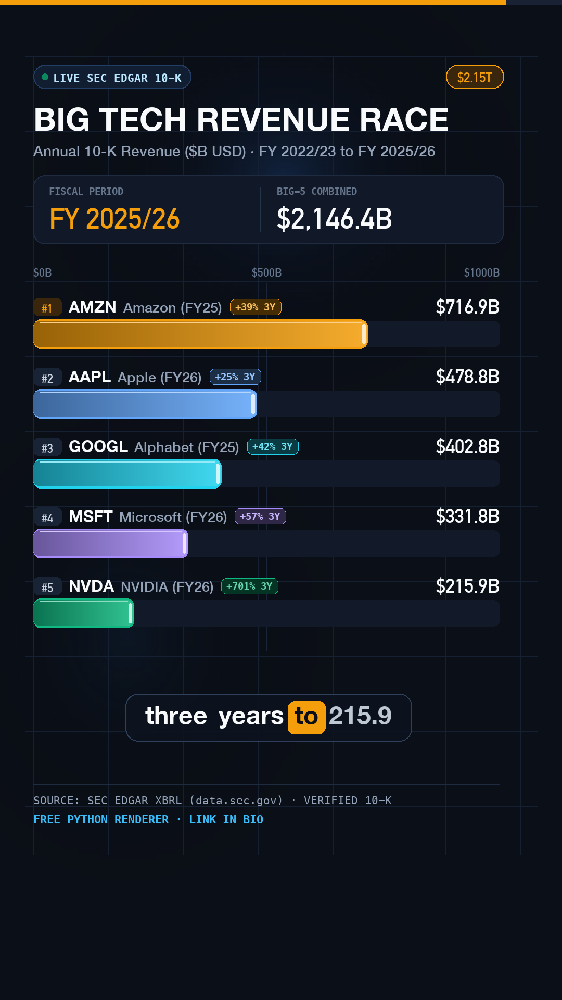
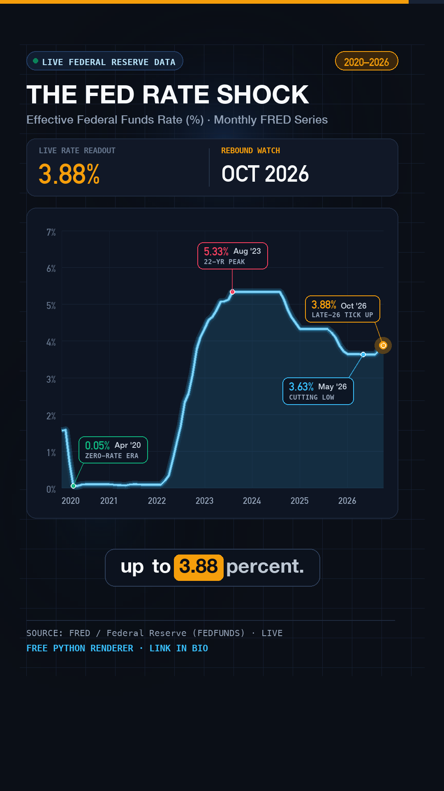
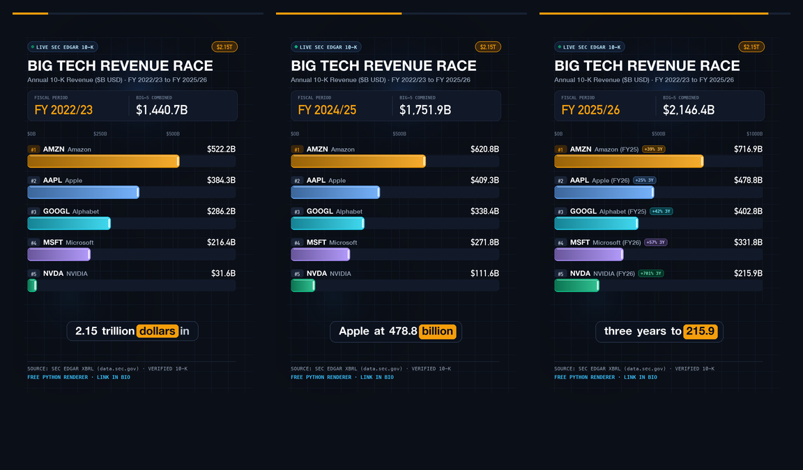
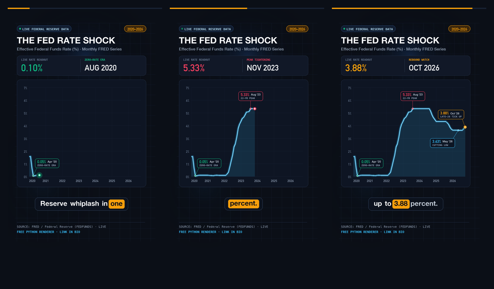

# Data Shorts Factory — Zero-Cost (`$0.00`) Programmatic `1080x1920` 30fps Kinetic Data-Chart Video Factory

Render crisp, broadcast-grade **vertical `1080x1920` 30fps H.264/AAC YouTube Shorts, TikToks, Reels, and X Videos** directly from **live public APIs (`SEC EDGAR XBRL` + `FRED`)** or any custom JSON dataset (English & Japanese) — locally on an 8 GB Mac at **`$0.00` marginal cost**.

> **Watch the rendered HD MP4s directly on your phone**: Download both live-rendered Shorts from **[Release `v1.0.0`](https://github.com/pecopeko/data-shorts-factory/releases/tag/v1.0.0)** (`short_01_bigtech_revenue_2026.mp4` & `short_02_fed_rate_curve_2020_2026.mp4`).

---

## Live Rendered Previews (`1080x1920` @ 30fps)

| Short 01 — Live SEC EDGAR 10-K Big Tech Revenue Race | Short 02 — Live FRED Federal Reserve Rate Shock (`2020–2026`) |
| :---: | :---: |
|  |  |
| **Live 10-K Data**: `AMZN $716.9B` · `AAPL $478.8B` · `GOOGL $402.8B` · `MSFT $331.8B` · `NVDA $215.9B (+701% 3Y)` (`$2.15T` combined) | **Live FRED `FEDFUNDS` (82 months)**: `0.05%` (Apr '20) → `5.33%` (Aug '23) → `3.63%` (May '26) → `3.88%` (Oct '26 uptick) |

### Motion Contact Sheets (Opening → Mid-Action → Finale)





---

## Why This Engine Passes 2026 Monetization Review (Anti-Slideshow Design)

- **True Frame-by-Frame Kinetic Motion (`30fps`)**: Smooth `ease_out_expo`, `ease_in_out_cubic`, and `ease_out_back` spring animations — multi-year animated horizontal bar races with dynamic rank swapping, rolling counters, glowing progressive time-series curves, pulsing live beacon dots, and animated milestone callout pins.
- **Word/Phrase-Synced Kinetic Captions**: Proportional cadence-weighted active word highlighting positioned strictly inside YouTube Shorts / TikTok safe zones (`y = 1332..1480`, keeping right edge clear of UI buttons and bottom clear of title bars).
- **Verified Primary-Source Provenance**: Zero hardcoded fake metrics — pulls live `data.sec.gov` XBRL Company Facts (with proper SEC Fair Access `User-Agent` and multi-tag `10-K` deduplication across `RevenueFromContractWithCustomerExcludingAssessedTax` & `Revenues`) and live `fred.stlouisfed.org` `FEDFUNDS` CSV.
- **Zero-Bloat Streaming Pipe (`< 250 MB` RAM on 8 GB Mac)**: Streams raw `rgb24` Pillow frames directly into `ffmpeg` stdin (`subprocess.Popen`) — **zero temporary PNG frame files** written to disk.
- **Zero-Cost Neural Narration + Copyright-Free Audio Bed**: Uses macOS `/usr/bin/say` (auto-selects `Ava (Premium)` / `Daniel` / `Samantha` for EN and `Kyoko` for JP), mastered via FFmpeg (`highpass`, presence EQ, `dynaudnorm`, 48kHz stereo) with a subtle procedural harmonic pulse bed synthesized via FFmpeg `aevalsrc` (0% Content ID risk). Optional `--tts-backend edge_tts` and `--tts-backend elevenlabs` adapters included.
- **Zero-Tofu Bilingual Typography (`EN` + `JA`)**: Uses macOS `Helvetica Neue`, `DIN Alternate Bold`, `Menlo`, and automatic `Hiragino Sans W8/W6` switching whenever CJK characters appear.

---

## Quickstart (1 Command)

### Requirements
- macOS with Python 3.9+ and `Pillow` (`PIL`)
- `ffmpeg` & `ffprobe` (`brew install ffmpeg`)

### Render Both Live Shorts (`SEC EDGAR` + `FRED`)
```bash
python3 cli.py batch
```

### Render Individual Live Shorts
```bash
# Live SEC EDGAR Big Tech Revenue Race
python3 cli.py bigtech --out out/short_01_bigtech_revenue_2026.mp4

# Live FRED Federal Reserve Rate Shock (2020-2026)
python3 cli.py fedfunds --out out/short_02_fed_rate_curve_2020_2026.mp4
```

### Render Any Custom Dataset JSON (English or Japanese)
```bash
# Custom English dataset (AI LLM token price collapse)
python3 cli.py custom \
  --spec examples/ai_token_price_drop_en.json \
  --out out/short_ai_token_prices.mp4 \
  --preview out/preview_ai.png

# Custom Japanese dataset (新NISA 20年積立の節税差額 — Hiragino Sans + Kyoko TTS)
python3 cli.py custom \
  --spec examples/japan_nisa_tax_savings_ja.json \
  --out out/short_jp_nisa.mp4 \
  --preview out/preview_jp.png
```

---

## Architecture

| File | Responsibility |
| :--- | :--- |
| [`timeline.py`](timeline.py) | Pure-Python easing primitives, multi-period bar race & rank-swap interpolation, progressive line-series state, word/phrase-synced kinetic subtitle engine, and JSON spec loader (zero third-party deps). |
| [`data_fetchers.py`](data_fetchers.py) | Live zero-API-key pullers for SEC EDGAR XBRL `companyfacts` (`AAPL`, `MSFT`, `NVDA`, `AMZN`, `GOOGL`) and FRED `FEDFUNDS` CSV, with strict error surfacing (`DataFetchError`, never silent fallbacks). |
| [`tts_audio.py`](tts_audio.py) | Auto-selecting macOS `/usr/bin/say` narration (`Ava (Premium)` / `Kyoko`), optional `edge_tts` / `elevenlabs` backends, FFmpeg vocal mastering + procedural ambient pulse bed, and `ffprobe` verifier. |
| [`video_renderer.py`](video_renderer.py) | Streaming `1080x1920` 30fps Pillow -> FFmpeg `rgb24` pipe renderer (`render_bar_race_short`, `render_macro_line_short`), automatic preview & 3-frame contact sheet exporter. |
| [`cli.py`](cli.py) | 1-command CLI (`batch`, `bigtech`, `fedfunds`, `custom`). |
| [`CHANNEL_MONETIZATION_PLAYBOOK.md`](CHANNEL_MONETIZATION_PLAYBOOK.md) | 2026 YouTube Shorts / TikTok / X Video high-RPM finance blueprint, anti-demonetization compliance checklist, daily batch schedule, and pinned-comment conversion funnel. |

---

## Related Open-Source Tools & Cloud Scrapers

- **Public-Intel MCP Server**: [github.com/pecopeko/mcp-public-intel](https://github.com/pecopeko/mcp-public-intel)
- **n8n AI Ops & Compliance Templates**: [github.com/pecopeko/n8n-ai-ops-templates](https://github.com/pecopeko/n8n-ai-ops-templates)
- **Cloud Batch Scrapers (Apify Store)**: [apify.com/pecopeko](https://apify.com/pecopeko)
- **Support Development**: [GitHub Sponsors](https://github.com/sponsors/pecopeko)

MIT License — built by Horizon-Money Studio (`pecopeko`).
