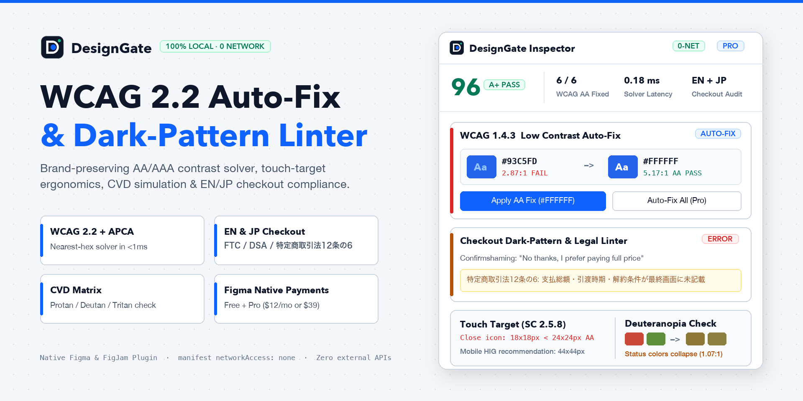

# DesignGate — Native Figma Plugin for WCAG 2.2 Auto-Fix & EN/JP Checkout Dark-Pattern Linting



> **Try it right now in your browser (zero install):**
> **[Live Interactive Figma Artboard Simulator → `https://pecopeko.github.io/designgate-figma-plugin/`](https://pecopeko.github.io/designgate-figma-plugin/)**

**DesignGate** is a zero-dependency, **100% local (`networkAccess: none`)** Figma & FigJam plugin built for product designers, design-system teams, and Japanese/global SaaS checkout designers. It pairs a `<1ms` **brand-preserving WCAG 2.2 AA/AAA + APCA Auto-Fix contrast solver** with an **EN & JP Checkout Dark-Pattern + Japan Tokushoho Art. 12-6 (特定商取引法12条の6) legal clarity linter**, touch-target ergonomics checks, and Viénot color-blindness simulation.

---

## Key Capabilities

1. **WCAG 2.2 AA/AAA + APCA Perceptual Contrast Engine & Nearest-Hex Auto-Fix Solver**
   - Exact IEC 61966-2-1 (`0.04045`) sRGB linearization, relative luminance, contrast ratio (`>= 4.5:1` normal text, `>= 3.0:1` large text `>= 24px` or `>= 18.66px bold`, `>= 3.0:1` UI components), and SAPC-4G APCA `Lc`.
   - Porter-Duff `source-over` alpha compositing across inherited ancestor fills and overlapping sibling background layers.
   - Binary-searches HSL lightness preserving brand hue and saturation (with 8-bit hex quantization verification) to compute the closest passing AA and AAA colors in `<1ms`, with **1-click canvas mutation** (`Cmd+Z` undo supported).

2. **Touch Target & Typography Ergonomics Linter**
   - Flags interactive controls (`BUTTON`, `CTA`, `INPUT`, `LINK`, `TAB`, `ICON_BUTTON`) failing **WCAG 2.2 SC 2.5.8 (`< 24×24px` AA)** or **Apple HIG / Material (`< 44×44px`)**.
   - Catches micro-text (`< 12px`, escalated to error at `< 10px`), tight body line-height (`< 1.2×`), missing `H1`, skipped heading levels (`H1 → H3`), and inverted heading scales.

3. **EN & JP Checkout Dark-Pattern & Japan Tokushoho Art. 12-6 Linter**
   - Detects **Confirmshaming** (EN & JP), **Fake Urgency / Countdown Pressure**, **Hidden / Fine-Print Auto-Renewal** (auto-escalated when combined with `< 12px` text or `< 4.5:1` contrast), **Phone-Only / Roach-Motel Cancellation Traps**, **Pre-Checked Paid Add-Ons**, and **Visual Asymmetry** on decline/cancel links.
   - Audits Japanese final-order / subscription checkout screens against **特定商取引法 第12条の6** mandatory disclosures (`分量・プラン`, `支払総額`, `支払時期・方法`, `引渡・提供時期`, `申込期間・解約条件`).

4. **Color-Blindness (CVD) Matrix Simulation (Viénot 1999)**
   - Simulates **Protanopia**, **Deuteranopia**, and **Tritanopia** in linearized sRGB.
   - Flags foreground/background contrast collapse (`< 3.0:1` under CVD) AND pairwise semantic status-badge indistinguishability (e.g., red vs. green chips collapsing to near-identical olive/brown under Deuteranopia).

5. **100% Local Privacy & Figma Community Native Payments (`figma.payments`)**
   - `manifest.json` explicitly declares `"networkAccess": { "allowedDomains": ["none"] }` — zero telemetry, zero external CDNs, zero data leaving Figma.
   - **Free Tier**: Single-frame contrast audit + 1-click AA/AAA Auto-Fix + ergonomics + EN/JP dark-pattern & CVD checks.
   - **Pro Tier (`$12/mo` or `$39` one-time via Figma Native Payments)**: Multi-frame full-page batch audit, 1-click **Auto-Fix All**, and **Markdown / CSV Dev-Handoff Accessibility Certificate** export.

---

## Project Structure

```text
designgate-figma-plugin/
├── manifest.json                      # Official Figma Plugin manifest (api 1.0.0, networkAccess: none)
├── code.js                            # Standalone Figma QuickJS sandbox bundle (zero runtime deps)
├── ui.html                            # Self-contained 360x580 Figma Plugin UI (zero external CDNs)
├── src/
│   ├── core/audit-engine.js           # Pure-JS shared WCAG/APCA/CVD/Dark-Pattern/Payments engine
│   └── figma/controller.js            # Figma SceneNode traversal, fill mutator & postMessage bridge
├── docs/
│   ├── index.html                     # Live interactive Browser Preview Simulator (GitHub Pages)
│   └── audit-engine.js                # Synced engine loaded by docs/index.html
├── assets/
│   ├── icon-128.png                   # 128x128 Figma Community plugin icon
│   └── community-cover-1920x960.png   # 1920x960 Figma Community cover art
├── scripts/
│   ├── build_plugin.mjs               # Zero-dep bundler (src/ -> code.js & docs/audit-engine.js)
│   └── generate_assets.py             # Pillow generator for icon & Community cover art
├── test/
│   └── designgate.test.mjs            # Full Node.js native test suite (`node --test`)
└── FIGMA_COMMUNITY_PUBLISH_GUIDE.md   # 5-minute $0.00 Figma Community + Native Payments guide
```

---

## Quick Start & Testing

```bash
# Run full unit & mocked-Figma integration test suite (Node 22+)
node --test test/designgate.test.mjs

# Rebuild standalone code.js & sync docs/audit-engine.js after editing src/
node scripts/build_plugin.mjs
```

To run inside **Figma Desktop** right now:
1. Open **Plugins → Development → Import plugin from manifest...**
2. Select `manifest.json`.
3. See [FIGMA_COMMUNITY_PUBLISH_GUIDE.md](FIGMA_COMMUNITY_PUBLISH_GUIDE.md) for the 5-minute `$0.00` Figma Community & Native Payments publishing steps.

## License

MIT — see [LICENSE](LICENSE).
