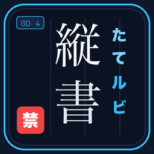

# Tokyo Tategaki & Furigana (`縦書き` + `ルビ` + `禁則処理`) for Godot 4



A lightweight, zero-dependency **Godot 4.x `@tool` Control node** (`TategakiNovelBox`) for rendering authentic **right-to-left Japanese vertical typography (`縦書き`)**, **Furigana / Ruby (`ルビ`)**, **Tate-Chu-Yoko (`縦中横`)**, and **JIS X 4051 Kinsoku Shori (`禁則処理`)** in Visual Novels (`NVL` Sound Novels like *Higurashi* / *Kamaitachi no Yoru*), Manga speech balloons (`フキダシ`), shrine plaques, and underground horror signage.

- **Author**: `peco` ([pecopeko.itch.io](https://pecopeko.itch.io) | [github.com/pecopeko](https://github.com/pecopeko))
- **Godot Compatibility**: Godot `4.0` – `4.6+` (Pure GDScript 2.0, works in Forward+, Mobile, and Web/HTML5 Compatibility renderers)
- **License**: MIT (`lite_repo`)

---

## Features / 主な機能

1. **Right-to-Left Vertical Columns (`縦書き`)**: Live `@tool` preview directly inside the Godot 4 2D Editor viewport.
2. **Authentic JIS X 4051 `禁則処理` (`Kinsoku Shori`)**:
   - **Head-Prohibited (`行頭禁則`)**: `。、，．・：；？！ー～」』）］｝〉》】` and small kana `ぁぃぅぇぉっゃゅょゎァィゥェォッャュョヮ` never start a wrapped column.
   - **Tail-Prohibited (`行末禁則`)**: Opening brackets `「『（［｛〈《【` never get stranded at the bottom of a column.
3. **Vertical CJK Glyph Transforms (`縦書き字形変換`)**:
   - Automatic `90°` clockwise rotation around glyph center for `ー` (chōonpu), `…`, `〜`, and brackets `「」『』（）【】《》` — works even with standard horizontal CJK fonts!
   - Upper-right quadrant placement for `。` / `、` and subtle vertical offset for small kana (`っゃゅょ`).
4. **Right-Margin Furigana / Ruby (`ルビ`)**:
   - Supports **Aozora Bunko / Syosetu (`小説家になろう`)** syntax: `｜東京《とうきょう》` and implicit kanji `異変《いへん》`
   - Supports **BBCode** syntax: `[ruby=とうきょう]東京[/ruby]`
5. **Tate-Chu-Yoko (`縦中横`)**:
   - Automatic upright horizontal numbers & paired marks (`8`, `24`, `!?`, `!!`) inside a single vertical cell, plus explicit `[tcy]8番[/tcy]` tags.
6. **Sound Novel Typewriter & Audio Hook**:
   - `chars_per_second`, automatic breath pauses on `。` / `、`, blinking vertical page-wait triangle cursor, and `character_revealed(character, char_index)` signal for typewriter audio blips.

---

## Installation / 導入方法

1. Copy `addons/tokyo_tategaki_furigana/` into your Godot 4 project's `res://addons/` folder (or install directly from the **Godot Asset Library**).
2. Open **Project -> Project Settings -> Plugins** and enable **Tokyo Tategaki & Furigana Novel Box**.
3. Add a **`TategakiNovelBox`** node to any 2D / UI scene and assign your Japanese `.ttf` / `.otf` / `.ttc` font (such as *Noto Serif CJK JP*, *Shippori Mincho*, or *M PLUS*) to `Custom Font` (or via your project `Theme`).

---

## Quick Usage (GDScript & Ruby Syntax)

```gdscript
extends Control

@onready var novel_box: TategakiNovelBox = $TategakiNovelBox
@onready var blip_player: AudioStreamPlayer = $BlipPlayer

func _ready() -> void:
	novel_box.character_revealed.connect(_on_character_revealed)
	novel_box.set_novel_text(
		"「｜東京《とうきょう》の[tcy]8番[/tcy]｜地下通路《ちかつうろ》で、\n"
		+ "｜異変《いへん》を｜見《み》つけたら——すぐに｜引《ひ》き｜返《かえ》すこと！？」",
		true # Start character-by-character typewriter reveal
	)

func _on_character_revealed(ch: String, _idx: int) -> void:
	if ch != " " and ch != "\n":
		blip_player.pitch_scale = randf_range(0.96, 1.05)
		blip_player.play()

func _unhandled_input(event: InputEvent) -> void:
	if event.is_action_pressed("ui_accept") and novel_box.is_typewriter_active():
		novel_box.skip_to_end()
```

### Supported Markup Cheatsheet

| Feature | Input Syntax | Rendered Output |
| :--- | :--- | :--- |
| Explicit Pipe Ruby (`青空文庫` / `なろう`) | `｜御神木《ごしんぼく》` | Vertical `御神木` + right-side `ごしんぼく` |
| Implicit Kanji Ruby | `地下通路《ちかつうろ》` | Vertical `地下通路` + right-side `ちかつうろ` |
| BBCode Ruby | `[ruby=とうきょう]東京[/ruby]` | Vertical `東京` + right-side `とうきょう` |
| Auto Tate-Chu-Yoko (`縦中横`) | `24時` / `本当!?` | Upright `24` / `!?` in a single vertical cell |
| Explicit Tate-Chu-Yoko | `[tcy]8番[/tcy]出口` | Upright `8番` badge in a single vertical cell |

---

## Upgrade to the Pro Horror Shader, Manga Balloon & Tokyo Audio Ecosystem

Building a commercial **Showa VHS Sound Novel**, **PS1 Retro Survival Horror**, **Exit-8 Anomaly Game**, or **Manga-styled Adventure** in Godot 4?

Check out our full commercial **Pro Suite** and companion **Tokyo 40-WAV Audio Kit** on **itch.io** ([https://pecopeko.itch.io](https://pecopeko.itch.io)):

- **Pro Addon (`tokyo_horror_anime_shaders`)**:
  - `MangaFukidashiBalloon.gd` — Procedural Manga speech balloons (`丸フキダシ`, `叫びウニフラッシュ` shout bursts, `心の声モコモコ` thought clouds, and `怨念ギザギザ` horror balloons) wrapping `TategakiNovelBox`!
  - `showa_vhs_camcorder.gdshader` — Authentic 1998 YIQ chroma bleed, bottom VHS head-switching tear band, scanline jitter & tape crease dropouts.
  - `psx_retro_horror_dither.gdshader` — `320x240` pixel downscale, 4x4 Bayer ordered dithering, 15-bit `RGB555` color quantization & cold fog.
  - `anime_cel_halftone_rim.gdshader` — 3-band toon spatial shader with rotated screen-space Manga screentone (`網点`) shadow dots & Fresnel rim.
  - `subway_anomaly_fluorescent_flicker.gdshader` — Eastern Japan 50Hz underground fluorescent ballast stutter & radial anomaly pulse.
- **Tokyo Visual Novel 40-WAV SFX + `既読` Smartphone Messenger UI Kit** ([https://pecopeko.itch.io](https://pecopeko.itch.io)):
  - 40 studio-clean `48kHz / 16-bit` Japanese school chimes, konbini bells, train crossings, shrine ambience, and VN typewriter/UI blips ready to wire straight into `TategakiNovelBox.character_revealed`!
